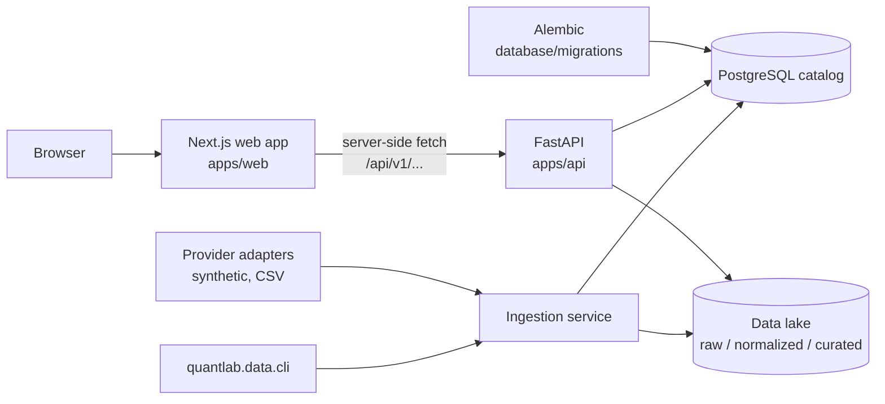

# System overview

Last updated: 2026-11-15 (Phase 3). This describes what is implemented, not the target
architecture. The target is in section 3 of the
[master specification](../../QUANTLAB_CODEX_MASTER_SPEC.md).

## Components today

- **Web (`apps/web`)**: Next.js App Router. Every screen is a server component rendered
  per request from API responses; the browser never calls the API and never sees
  `API_BASE_URL`. Screens: Overview (health, data freshness, watchlist), Markets
  (instrument search, per-instrument coverage, watchlist), instrument page (daily close and
  volume chart, gap list, comparison, bars table, symbol history) and Stock Screener.
  `lib/market.ts` validates every payload with zod; `lib/format.ts` formats decimal strings
  without float arithmetic; `lib/chart.ts` is chart geometry. The chart and the navigation
  are the only client components. The watchlist button posts to a server action.
- **API (`apps/api`)**: FastAPI. Routes: health and readiness, instruments, daily bars with
  gap ranges, coverage, comparison, screener, dataset provenance (snapshots, quarantine
  reports, ingestion runs) and the watchlist. Only the watchlist routes write. Every error
  response uses one envelope: `{"error": {"code", "message", "details"}}`.
- **Market data (`quantlab/data`)**:
  - `providers/`: the provider boundary and two adapters. Providers return source bytes;
    parsers, registered by format, turn stored bytes into provider-neutral records.
  - `validation/`: record-level rules. Each record is accepted or quarantined with reasons.
  - `storage/catalog.py`: instrument master, raw-object records, snapshots, runs, audit.
  - `storage/lake.py`: content-addressed raw files, normalized run output, curated
    snapshots as Parquet with a manifest.
  - `ingestion/service.py`: fetch, store raw, fingerprint, validate, publish; plus
    `reproduce_snapshot`.
  - `query.py`: snapshot resolution and bar reads.
  - `analytics.py`: coverage, gap ranges, n-session returns, average volume, rebased
    comparison. Deterministic, `Decimal`-based, tested against hand-calculated cases.
  - `cli.py`: `ingest-synthetic`, `ingest-csv`, `snapshots`, `reproduce`.
- **Backtesting (`quantlab/backtesting`)**: a pure library with no dependency on the API,
  database or AI code. `engine.py` is the event-driven simulation, `costs.py` the
  effective-dated cost schedule, `strategy.py` the strategy interface with the
  moving-average and buy-and-hold strategies, `metrics.py` the performance statistics.
  `runner.py` loads bars from a snapshot and assembles a report with provenance and
  limitations; `cli.py` runs it. Not exposed through the API or the web app. See
  [the methodology](../research_methodology/backtesting.md) and
  [ADR 0006](../adr/0006-backtesting-engine.md).
- **Settings (`quantlab/common/settings.py`)**: the single place environment configuration
  is read and validated. Unsupported execution or broker modes fail at startup.
- **Database**: PostgreSQL, managed by hand-written Alembic migrations. `audit_events`
  rejects UPDATE and DELETE through a trigger. Ingestion writes audit events.

Design decisions are in [ADR 0004](../adr/0004-market-data-storage.md) (data layer) and
[ADR 0005](../adr/0005-market-explorer.md) (market explorer);
schemas and rules are in the [data dictionary](../data_dictionary/daily-bars.md).

## Not implemented

Authentication, a licensed data provider, trading calendar, corporate actions, index
constituents, fundamentals, indicator overlays, saved screens, experiment registry,
walk-forward validation, ML, portfolio/risk, AI
orchestration, background workers, Redis, MLflow, paper trading and broker adapters.

## Known limitations

- No authentication exists. The API must not be exposed beyond localhost in this state.
- Ingestion runs synchronously from the CLI; there is no job queue, retry or dead-letter
  handling yet.
- `audit_events` can still be truncated or dropped by the application's database role.
- Readiness checks that the database answers, not that migrations are current.
- The lake is a local directory with no backup procedure.
- The API and web app have no Dockerfiles; Compose provides PostgreSQL only.
- The watchlist is one shared list with no owner.
- No browser end-to-end tests in the repository or CI.
- No property-based tests yet (spec section 16.1); validation is covered by example-based
  tests.
