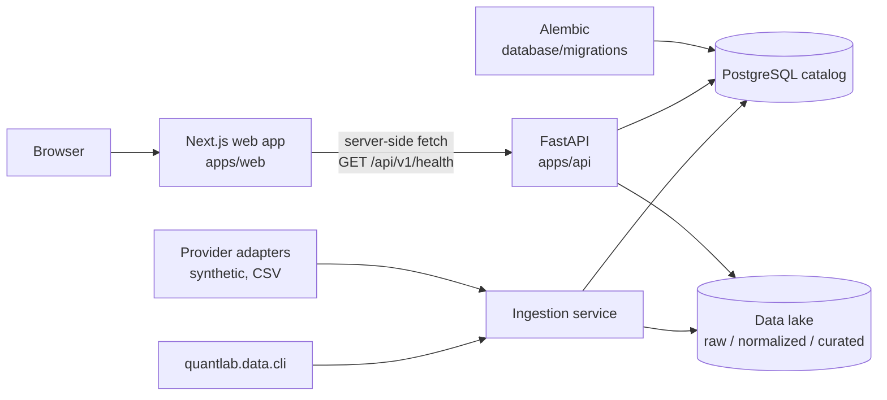

# System overview

Last updated: 2026-11-14 (Phase 1). This describes what is implemented, not the target
architecture. The target is in section 3 of the
[master specification](../../QUANTLAB_CODEX_MASTER_SPEC.md).

## Components today

- **Web (`apps/web`)**: Next.js App Router. The Overview page is a server component that
  calls the API health endpoint on each request and shows either the reported status or an
  explicit "unreachable" state. The browser never calls the API directly and never sees
  `API_BASE_URL`. It displays no market data yet (Phase 2).
- **API (`apps/api`)**: FastAPI, read-only. Routes: health and readiness, instruments,
  daily bars, and dataset provenance (snapshots, quarantine reports, ingestion runs). Every
  error response uses one envelope: `{"error": {"code", "message", "details"}}`.
- **Market data (`quantlab/data`)**:
  - `providers/`: the provider boundary and two adapters. Providers return source bytes;
    parsers, registered by format, turn stored bytes into provider-neutral records.
  - `validation/`: record-level rules. Each record is accepted or quarantined with reasons.
  - `storage/catalog.py`: instrument master, raw-object records, snapshots, runs, audit.
  - `storage/lake.py`: content-addressed raw files, normalized run output, curated
    snapshots as Parquet with a manifest.
  - `ingestion/service.py`: fetch, store raw, fingerprint, validate, publish; plus
    `reproduce_snapshot`.
  - `query.py`: snapshot resolution and bar reads.
  - `cli.py`: `ingest-synthetic`, `ingest-csv`, `snapshots`, `reproduce`.
- **Settings (`quantlab/common/settings.py`)**: the single place environment configuration
  is read and validated. Unsupported execution or broker modes fail at startup.
- **Database**: PostgreSQL, managed by hand-written Alembic migrations. `audit_events`
  rejects UPDATE and DELETE through a trigger. Ingestion writes audit events.

Design decisions for the data layer are in [ADR 0004](../adr/0004-market-data-storage.md);
schemas and rules are in the [data dictionary](../data_dictionary/daily-bars.md).

## Not implemented

Authentication, a licensed data provider, trading calendar, corporate actions, index
constituents, fundamentals, market explorer UI, backtesting, ML, portfolio/risk, AI
orchestration, background workers, Redis, MLflow, paper trading and broker adapters.

## Known limitations

- No authentication exists. The API must not be exposed beyond localhost in this state.
- Ingestion runs synchronously from the CLI; there is no job queue, retry or dead-letter
  handling yet.
- `audit_events` can still be truncated or dropped by the application's database role.
- Readiness checks that the database answers, not that migrations are current.
- The lake is a local directory with no backup procedure.
- The API and web app have no Dockerfiles; Compose provides PostgreSQL only.
- No property-based tests yet (spec section 16.1); validation is covered by example-based
  tests.
