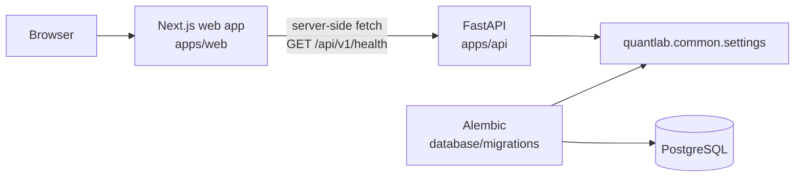

# System overview

Last updated: 2026-11-12 (Phase 0). This describes what is implemented, not the target
architecture. The target is in section 3 of the
[master specification](../../QUANTLAB_CODEX_MASTER_SPEC.md).

## Components today

- **Web (`apps/web`)**: Next.js App Router. The Overview page is a server component that
  calls the API health endpoint on each request and shows either the reported status or an
  explicit "unreachable" state. The browser never calls the API directly and never sees
  `API_BASE_URL`. Navigation lists the planned sections; only implemented ones are links,
  and Execution is not listed.
- **API (`apps/api`)**: FastAPI with one route, `GET /api/v1/health`. It reports liveness
  and the configured execution mode. It does not check the database.
- **Settings (`quantlab/common/settings.py`)**: the single place environment configuration
  is read and validated. Unsupported execution or broker modes fail at startup.
- **Database**: PostgreSQL, managed by Alembic. One migration creates `audit_events`.
  No application code reads or writes the database yet.

## Not implemented

Authentication, market data, backtesting, ML, portfolio/risk, AI orchestration, background
workers, Redis, MLflow, paper trading and broker adapters. None of these have code or
placeholders in the repository.

## Known limitations

- `audit_events` is not yet protected against UPDATE/DELETE at the database level.
- There is no readiness endpoint; health is process liveness only.
- No authentication exists. The API must not be exposed beyond localhost in this state.
- The API and web app have no Dockerfiles; Compose provides PostgreSQL only.
